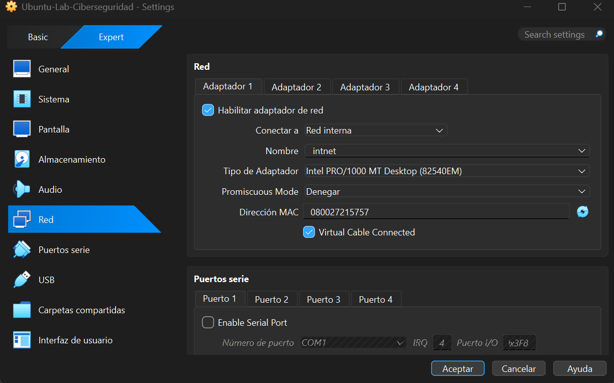
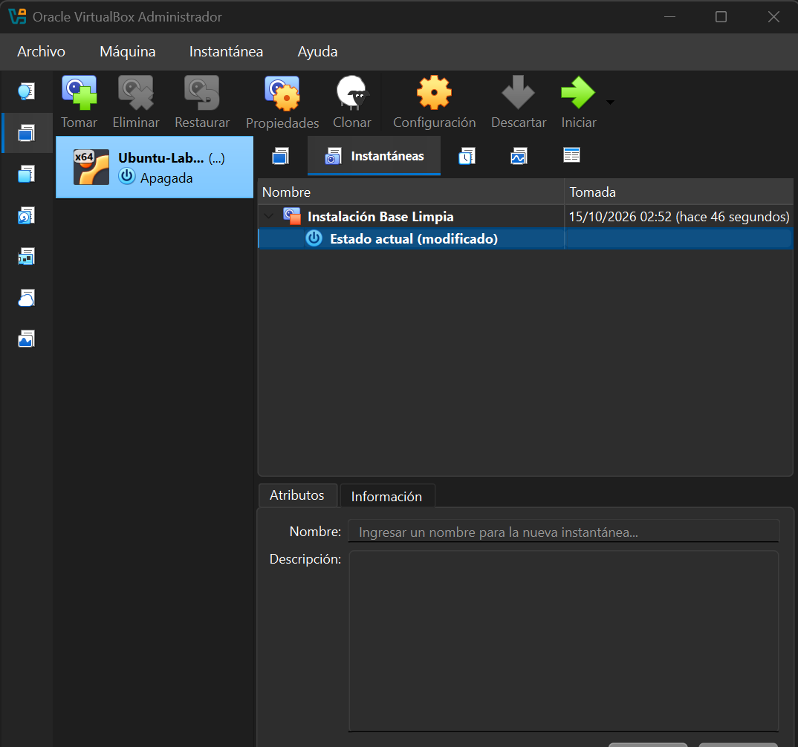

# Laboratorio de Ciberseguridad con VirtualBox

## 1. Objetivo

El objetivo de este laboratorio es preparar un entorno virtual de pruebas utilizando Oracle VirtualBox y Ubuntu. La práctica busca aplicar los conceptos de virtualización, aislamiento y seguridad, evitando exponer innecesariamente el equipo anfitrión y la red doméstica.

## 2. Entorno utilizado

- **Hipervisor:** Oracle VirtualBox 7.2.20.
- **Sistema operativo invitado:** Ubuntu Desktop 22.04.5 LTS (64 bits).
- **Máquina virtual:** Ubuntu-Lab-Ciberseguridad.
- **Memoria RAM asignada:** 4096 MB (4 GB).
- **Procesadores virtuales:** 2.
- **Disco virtual:** 35 GB, formato VDI y asignación dinámica.
- **Red:** Red Interna (Internal Network).
- **Nombre de la red:** `intnet`.

## 3. Configuración de red y justificación técnica

Se seleccionó el modo **Red Interna (Internal Network)** porque el objetivo inicial es disponer de un entorno de práctica aislado que no necesita acceso a Internet ni comunicación directa con el sistema anfitrión.

Este modo permite la comunicación entre máquinas virtuales conectadas a la misma red interna, sin proporcionar conectividad directa con el equipo anfitrión ni con Internet.

No se seleccionó el modo **Adaptador Puente (Bridged)** porque conecta la máquina virtual directamente a la red local como si fuera otro dispositivo físico. Esto podría aumentar la exposición de la máquina virtual frente a otros equipos de la red doméstica.

El aislamiento reduce la superficie de exposición, aunque no garantiza una protección absoluta. Por ello, se mantienen deshabilitados el portapapeles compartido, la función de arrastrar y soltar y las carpetas compartidas que no sean necesarias.

### Evidencia de la configuración de red

## 4. Instantánea de recuperación

Se creó una instantánea con el nombre **Instalación Base Limpia** para conservar un punto de restauración de la máquina virtual antes de realizar prácticas posteriores.

Las instantáneas permiten volver a un estado anterior de la máquina virtual si una prueba provoca cambios no deseados. No sustituyen a las copias de seguridad independientes.

### Evidencia de la instantánea

## 5. Buenas prácticas aplicadas

- Asignar recursos virtuales moderados para conservar recursos del equipo anfitrión.
- Utilizar una red interna para las prácticas que no requieren conectividad externa.
- Evitar el intercambio innecesario de archivos entre el anfitrión y la máquina invitada.
- Crear una instantánea antes de realizar cambios o pruebas importantes.
- Descargar el software desde fuentes oficiales.
- Mantener el sistema actualizado cuando se habilite una conexión de red apropiada y controlada.

## 6. Conclusión

Se preparó un laboratorio virtual con Ubuntu para realizar futuras prácticas de ciberseguridad. La configuración prioriza el aislamiento de red, la reducción de canales de intercambio con el equipo anfitrión y la posibilidad de recuperar un estado conocido mediante instantáneas.

Este entorno constituye una base de aprendizaje. Antes de ejecutar herramientas o analizar archivos sospechosos, será necesario evaluar los riesgos de cada actividad y mantener las medidas de aislamiento adecuadas.
