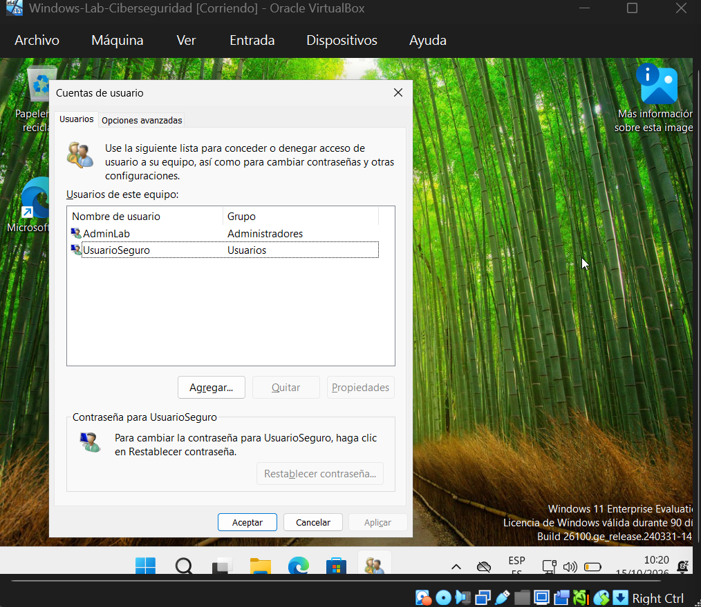
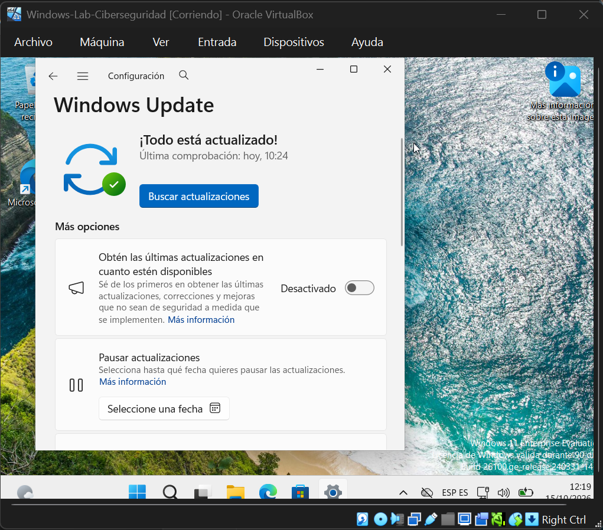
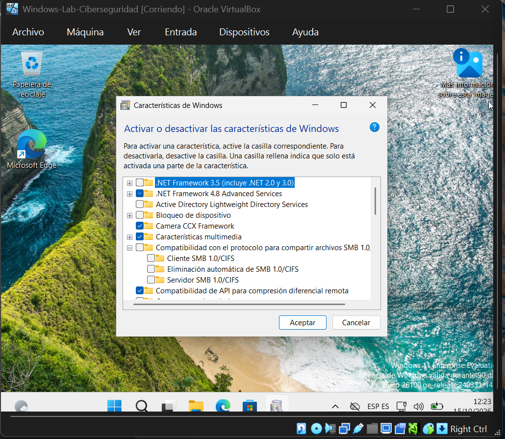
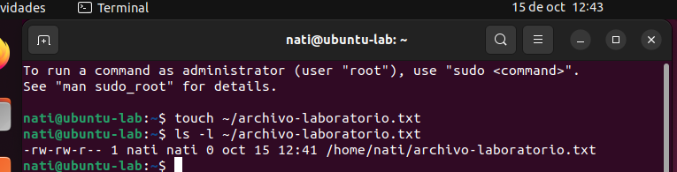
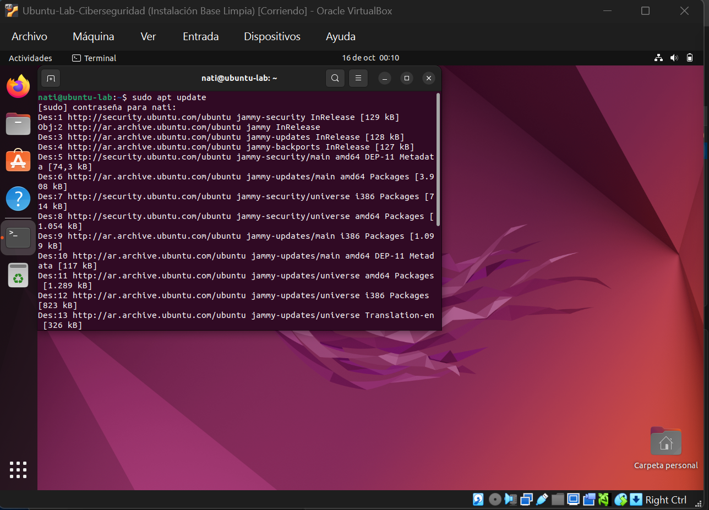
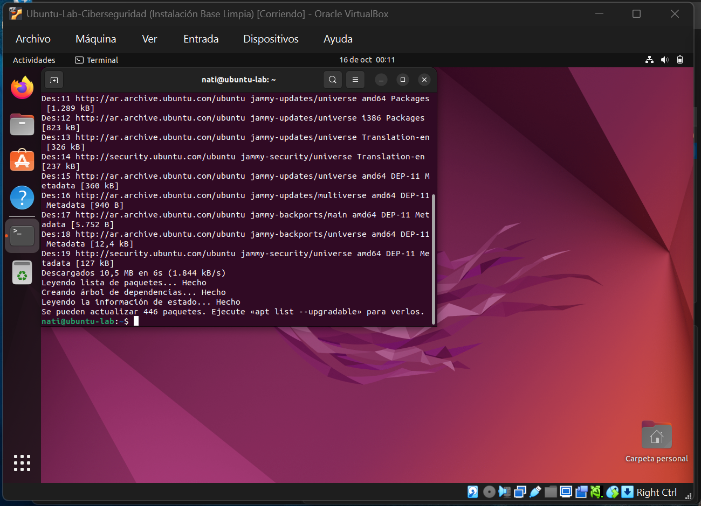
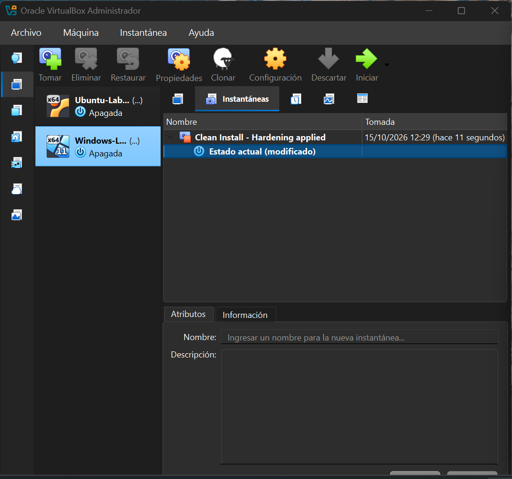

# Laboratorio de Ciberseguridad con VirtualBox

**Estudiante:** Natalia Alvarez  
**Módulo:** 2 — Protegiendo el sistema operativo (Windows/Linux)

## 1. Objetivo

Preparar y documentar un entorno de prácticas usando Oracle VirtualBox y aplicar medidas básicas de hardening en Windows y fundamentos de permisos y gestión de paquetes en Ubuntu. El objetivo es practicar aislamiento, mínimo privilegio, actualizaciones y recuperación mediante instantáneas.

## 2. Entorno utilizado

### Ubuntu
- **Hipervisor:** Oracle VirtualBox 7.2.20.
- **Sistema invitado:** Ubuntu Desktop 22.04.5 LTS (64 bits).
- **VM:** `Ubuntu-Lab-Ciberseguridad`.
- **Recursos:** 4096 MB de RAM, 2 CPU virtuales, disco VDI dinámico de 35 GB.
- **Red para la práctica:** Red Interna (`intnet`). Se cambió temporalmente a NAT para ejecutar `sudo apt update` y luego se restauró Red Interna.

### Windows
- **Sistema invitado:** Windows 11 Enterprise Evaluation (64 bits).
- **VM:** `Windows-Lab-Ciberseguridad`.
- **Recursos:** 4096 MB de RAM, 2 CPU virtuales, disco VDI dinámico de 64 GB.
- **Red:** NAT para permitir la conectividad saliente requerida por Windows Update.

## 3. Configuración y aislamiento de red

Ubuntu quedó configurada en **Red Interna (`intnet`)**. Este modo permite comunicación entre las VMs conectadas a la misma red interna, pero no da acceso directo a Internet ni conecta directamente a la VM con el host. Se utilizó NAT de forma temporal para actualizar el índice de paquetes y luego se restituyó la red interna.

No se eligió modo Puente porque conectaría la VM a la red local como un dispositivo más, aumentando su exposición. NAT permite conectividad saliente útil para actualizaciones sin poner a la VM directamente en la red doméstica; no debe confundirse con aislamiento absoluto.


## 4. Instantánea de la instalación base

Se creó la instantánea **`Instalación Base Limpia`** con Ubuntu apagado. Este punto de restauración permite recuperar el estado base si una práctica posterior produce cambios inesperados.


## 5. Windows: hardening básico

### 5.1 Principio de menor privilegio

Se mantuvo una cuenta administrativa separada (`AdminLab`) y se creó `UsuarioSeguro`, que aparece en el grupo `Usuarios` y no en `Administradores`. Para tareas habituales se recomienda utilizar la cuenta estándar y reservar la elevación administrativa para tareas que realmente la necesiten.



### 5.2 Windows Update

Windows Update mostró **«¡Todo está actualizado!»** después de completar las actualizaciones detectadas.



### 5.3 Desactivación de SMB 1.0/CIFS

En las características de Windows se verificó que SMB 1.0/CIFS y los subcomponentes Cliente, Eliminación automática y Servidor están desmarcados. Si el protocolo heredado no es necesario, mantenerlo deshabilitado reduce funcionalidades innecesarias y la superficie de ataque.



## 6. Linux: permisos de archivo y gestión de paquetes

Se creó `~/archivo-laboratorio.txt` y se consultaron sus permisos mediante `ls -l`. El resultado observado fue:

```text
-rw-rw-r-- 1 nati nati 0 oct 15 12:41 /home/nati/archivo-laboratorio.txt
```

El archivo tiene lectura y escritura para el propietario y su grupo, y lectura para otros usuarios; no tiene permiso de ejecución.



Se ejecutó `sudo apt update` con Ubuntu temporalmente en NAT. El proceso finalizó leyendo las listas de paquetes y actualizando el índice local; informó que había 446 paquetes actualizables. `apt update` refresca la información disponible de los repositorios, pero no instala esas actualizaciones por sí mismo.





## 7. Instantánea de hardening

Como evidencia complementaria del checkpoint, se creó en Windows la instantánea **`Clean Install - Hardening applied`** con la VM apagada. La instantánea conserva el estado de esa máquina en el momento de su creación, pero no sustituye una copia de seguridad independiente.



## 8. Conclusión

El laboratorio combina aislamiento de red, cuentas separadas por privilegios, actualizaciones y desactivación de un protocolo heredado que no se necesita. Las instantáneas aportan puntos de recuperación antes de prácticas posteriores. La virtualización reduce el riesgo para el equipo anfitrión, pero no es una garantía absoluta: conviene limitar integraciones con el host, elegir cuidadosamente la red y practicar solo en entornos controlados.
